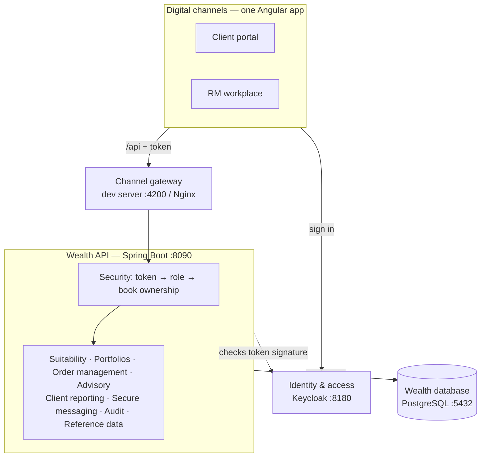

# Wealth Portal

A wealth-banking portal for **clients**, **relationship managers (RMs)** and
**compliance**, in the style of front-office wealth platforms: MiFID II
suitability profiling, portfolios, security and derivative orders with
pre-trade checks, investment proposals with e-signature, PDF statements and
secure messaging.

**Stack:** Angular 22 · Spring Boot 4.1 (Java 25) · PostgreSQL 17 · Keycloak 26 ·
Docker · GitHub Actions

> Demo project. All prices are sample values, not market data.

📘 **[Functional overview](docs/FUNCTIONAL_OVERVIEW.md)** — the full description
in wealth terms: actors and entitlements, data model, MiFID II suitability,
order management and pre-trade checks, advisory proposals, client reporting,
messaging, audit and architecture.

---

## Contents

1. [What it does](#1-what-it-does)
2. [Quick start (Windows, one command)](#2-quick-start-windows-one-command)
3. [Run it by hand](#3-run-it-by-hand)
4. [Test users and addresses](#4-test-users-and-addresses)
5. [Demo walkthrough](#5-demo-walkthrough)
6. [API](#6-api)
7. [Business rules](#7-business-rules)
8. [Demo data](#8-demo-data)
9. [Tests and CI](#9-tests-and-ci)
10. [Project layout](#10-project-layout)
11. [How sign-in and security work](#11-how-sign-in-and-security-work)
12. [Roadmap](#12-roadmap)
13. [Troubleshooting](#13-troubleshooting)
14. [Deploy to Azure (free tier)](#14-deploy-to-azure-free-tier)

---

## 1. What it does

| Area | Relationship manager | Client | Admin / compliance |
|---|---|---|---|
| **Home** | AUM, clients, MiFID problems, high-cash portfolios, proposals waiting over 5 days, orders awaiting compliance | Total wealth, investor profile, portfolios | Orders awaiting approval |
| **Clients** | Book of clients, search, "MiFID action needed" filter, client page | — | — |
| **MiFID II** | Questionnaire wizard with live risk score, save and resume, client decision, on-screen signature, profile history | Sees own profile | — |
| **Portfolios** | Value, 12-month performance chart, allocation, holdings (shares, bonds, funds, ETFs, options, futures) | Own portfolios only | — |
| **Orders** | Security and derivative ticket, live pre-trade checks and costs, blotter, cancel | Execution-only portfolios only | Approve or reject (four-eyes rule) |
| **Proposals** | Build, send, record signature, convert to orders, PDF | Accept and sign, or decline, PDF | — |
| **Reports** | Statement, valuation, performance, transactions, ex-post costs (PDF, generated in the background) | Same, own portfolios | — |
| **Messages** | One secure conversation per client, unread badge | Conversation with their RM | — |

Every feature is a Spring Boot REST API first; the Angular screens call those
APIs. All of them can be tried in Swagger UI.

### Architecture at a glance



The request flow, business rules per module and the full domain model are in
the [functional overview](docs/FUNCTIONAL_OVERVIEW.md#10-technical-architecture-and-request-flow).

---

## 2. Quick start (Windows, one command)

**Install once:** Git, JDK 25 (Temurin), Maven 3.9+, Node.js 24 LTS (or 22.22.3+),
Docker Desktop, VS Code. Check with `mvn -v` (must say *Java version: 25*),
`node -v`, `docker --version`.

Put `wealth-portal.zip` and `setup-wealth.ps1` in your **Downloads** folder, then
in PowerShell:

```powershell
powershell -ExecutionPolicy Bypass -File "$env:USERPROFILE\Downloads\setup-wealth.ps1"
```

The script checks your tools, extracts the project to `D:\Projects\wealth-portal`,
starts Docker, PostgreSQL and Keycloak, opens a **Wealth backend** window and a
**Wealth frontend** window, waits until both answer, and opens the app and
Swagger UI. First run: 5–10 minutes (downloads). Later: about a minute.

| Afterwards | Command |
|---|---|
| Start again (no unzip, keep users) | `powershell -ExecutionPolicy Bypass -File "D:\Projects\wealth-portal\setup-wealth.ps1" -SkipExtract -KeepKeycloak` |
| Install an update (new zip in Downloads) | `powershell -ExecutionPolicy Bypass -File "$env:USERPROFILE\Downloads\setup-wealth.ps1" -KeepKeycloak` |
| Stop everything | `powershell -ExecutionPolicy Bypass -File "D:\Projects\wealth-portal\setup-wealth.ps1" -Stop` |

Leave out `-KeepKeycloak` to reset Keycloak to the users and settings in
`keycloak/wealth-realm.json`.

---

## 3. Run it by hand

Open the `wealth-portal` folder in VS Code (accept the recommended extensions),
then use three terminals:

```powershell
# Terminal 1 — PostgreSQL and Keycloak
docker compose up -d

# Terminal 2 — backend on http://localhost:8090
cd backend
mvn spring-boot:run

# Terminal 3 — frontend on http://localhost:4200
cd frontend
npm install
npm start
```

**Everything in containers** (closest to Azure, no local Java or Node needed):

```powershell
docker compose --profile app up --build -d     # app on http://localhost:8081
docker compose --profile app down              # stop; add -v to wipe all data
```

---

## 4. Test users and addresses

| User | Password | Choose on login page | Lands on |
|---|---|---|---|
| `rm1` | `Manager#2026` | Relationship manager | RM homepage (7 clients) |
| `client1` | `Client#2026` | Client | Clara Dupont's portfolios |
| `admin1` | `Admin#2026x` | Relationship manager | Admin / compliance homepage |

Two-factor is switched off for these demo users. To switch it back on, see
`keycloak/README.txt`.

| What | Address |
|---|---|
| App (dev server) | http://localhost:4200 |
| App (containers) | http://localhost:8081 |
| Swagger UI | http://localhost:8090/swagger-ui.html |
| API health | http://localhost:8090/actuator/health |
| Keycloak admin console | http://localhost:8180 (admin / admin) |
| PostgreSQL | localhost:5432 · database `wealth` · user `wealth` · password `wealth` |

---

## 5. Demo walkthrough

**As rm1**

1. **Home** — real AUM, MiFID counters, a proposal waiting over 5 days, an order awaiting compliance.
2. **Clients** → *Liam O'Connor* (no profile) → **Profile now** → answer 4 steps → **Accepted**, sign → profile *Valid*.
3. **Clients** → *Pieter de Vries* → *Opportunities* — options and a future in the holdings.
4. On that portfolio: **New order** → ASML → 40 → concentration **warning** → **Submit for approval**.
5. *Hans Becker* → *Managed growth* — no **New order** button: discretionary portfolio.
6. **Proposals** → *Add short-dated government bonds* (draft) → **Send to client**.
7. Any portfolio → **Reports and statements** → **Client statement** → **Download**.
8. **Messages** → Amélie's unread message (badge in the menu) → reply.

**As admin1** — **Approvals** → approve the ASML order (it fills at the demo price).

**As client1** — **Proposals** → sign → **Accept and sign** → back as rm1: **Place the orders**.
Clara can also trade her *Trading account* (execution-only) and message her RM.

---

## 6. API

Interactive documentation: **http://localhost:8090/swagger-ui.html** — click
**Authorize**, sign in as a test user, then **Try it out**.
In VS Code: `backend/requests.http` (REST Client extension) signs in and calls
every endpoint.

| Area | Endpoints |
|---|---|
| Session | `GET /api/me` · `POST /api/session/start` |
| Homepages | `GET /api/rm/home` · `GET /api/admin/home` |
| Clients | `GET /api/rm/clients?q=` · `GET /api/clients/{id}` · `GET /api/client/me` |
| Instruments | `GET /api/instruments?q=&assetClass=` · `GET /api/instruments/{id}` |
| Portfolios | `GET /api/portfolios/{id}` |
| MiFID | `GET /api/mifid/questionnaire` · `GET /api/clients/{id}/mifid` · `POST /api/rm/clients/{id}/mifid/reviews` · `GET /api/rm/mifid/reviews/{id}` · `PUT …/answers` · `POST …/finish` · `POST …/cancel` |
| Orders | `POST /api/orders/preview` · `POST /api/orders` · `GET /api/orders?portfolioId=&status=` · `POST /api/orders/{id}/cancel` · `POST /api/admin/orders/{id}/approve` · `POST /api/admin/orders/{id}/reject` |
| Proposals | `GET /api/proposals?portfolioId=` · `GET /api/proposals/{id}` · `GET /api/proposals/{id}/pdf` · `POST /api/rm/proposals` · `PUT /api/rm/proposals/{id}` · `DELETE /api/rm/proposals/{id}` · `POST /api/rm/proposals/{id}/send` · `POST /api/proposals/{id}/validate` · `POST /api/proposals/{id}/reject` · `POST /api/rm/proposals/{id}/execute` |
| Reports | `GET /api/portfolios/{id}/reports` · `POST /api/portfolios/{id}/reports` · `GET /api/reports/{id}/download` · `DELETE /api/reports/{id}` |
| Messages | `GET /api/messages/threads` · `GET /api/messages/threads/{clientId}` · `POST /api/messages/threads/{clientId}` · `GET /api/messages/unread-count` |

Errors come back as standard problem-detail JSON (RFC 9457).
Records a user may not see answer **404**, so ids can't be probed.

---

## 7. Business rules

**MiFID II suitability** (questionnaire 2026.1)
- 7 scored questions (objectives, horizon, income, share of wealth, reserves, reaction to losses, maximum loss), 1–4 points each → total 7–28 → risk profile **1 Conservative … 5 Dynamic**.
- Complex products are appropriate only with derivatives experience **and** the right answer to the leverage question.
- Client decision: *Accepted* (signature required, valid 12 months, replaces the old profile), *Under review*, or *Refused* (old profile stays).

**Pre-trade checks** — every order and every proposal line
| Check | Fails (blocked) | Warns (needs compliance approval) |
|---|---|---|
| Service type | Discretionary portfolio | — |
| Cash | Not enough cash for a buy | — |
| Holding | Selling more shares than held | Selling more contracts than held (short) |
| MiFID profile | Advisory portfolio without a valid profile | Execution-only without a profile |
| Risk match | — | Instrument risk class above profile + 2 |
| Appropriateness | Complex product on advisory without knowledge | Complex product on execution-only without knowledge |
| Concentration | — | One instrument above 20% of the portfolio |

**Who may place orders:** the client's RM or an admin on advisory and
execution-only portfolios; the client themselves only on execution-only ones.
An admin can't approve an order they created (four-eyes rule).

**Fees:** securities 0.25% of the amount, derivatives 2.50 per contract,
minimum 15; a negotiated commission replaces the standard one.

**Execution (simulated):** market orders fill at the last price; limit orders
fill if the limit is already reached, otherwise stay *Placed*; stop orders wait.

**Proposals** (advisory portfolios only): *Draft → Awaiting client → Accepted →
Executed*, or *Declined*. Editing a sent proposal returns it to draft. Lines that
fail a check block sending.

**Audit trail:** sign-ins, MiFID decisions, orders, approvals, proposals and
reports are written to an insert-only table; the database itself refuses edits.

---

## 8. Demo data

Loaded by Flyway from `backend/src/main/resources/db/demo/R__demo_data.sql`:

- 21 instruments: shares, ETFs, funds, bonds, ASML and SAP options, a Euro Stoxx 50 future
- 8 clients (7 for `rm1`, 1 for another RM to show book separation), 9 portfolios of every service type
- 12 months of performance history per portfolio
- MiFID profiles in every state: valid, expired, missing, awaiting the client, in progress
- Filled, placed and awaiting-approval orders; draft, sent and executed proposals; messages

Changing that file reloads the demo data on the next backend start and **resets**
clients, portfolios, MiFID profiles, orders, proposals, reports and messages.
Users and the audit trail are never touched. Production runs with
`FLYWAY_LOCATIONS=classpath:db/migration`, which skips the demo data.

---

## 9. Tests and CI

```powershell
cd backend;  mvn verify          # JUnit: rules, services, security, PDF
cd frontend; npm run test:ci     # Vitest: guards, pages, order-ticket form rules
```

GitHub Actions on every push and pull request:

| Workflow | What it does |
|---|---|
| **CI** | Backend build and tests (JDK 25) · frontend tests and production build (Node 24) · Docker images build |
| **CodeQL** | Security scan of Java and TypeScript, weekly and on every change |
| **Dependabot** | Weekly update pull requests for Maven, npm, Docker images and Actions |

Recommended on GitHub: **Settings → Branches →** protect `main`, require a pull
request and the checks *Backend*, *Frontend* and *Docker images build*.
**Settings → Code security →** turn on Dependabot alerts and secret scanning.

---

## 10. Project layout

```
wealth-portal/
├── setup-wealth.ps1            one-command setup / start / stop for Windows
├── docker-compose.yml          PostgreSQL + Keycloak (+ app with --profile app)
├── keycloak/                   realm: roles, test users, clients
├── .github/                    CI, CodeQL, Dependabot
├── backend/                    Spring Boot 4 API (port 8090)
│   ├── requests.http           ready-made API calls
│   └── src/main/
│       ├── java/com/yourbank/wealth/
│       │   ├── identity/       current user, sign-in history
│       │   ├── client/         clients and the access rules (who sees whom)
│       │   ├── book/           RM book, client pages, homepages
│       │   ├── mifid/          questionnaire, scoring, review workflow
│       │   ├── instrument/     security master
│       │   ├── portfolio/      positions, cash, valuation, history
│       │   ├── order/          orders, pre-trade checks, fees, execution, approval
│       │   ├── proposal/       proposals, lifecycle, PDF
│       │   ├── report/         report jobs, background worker, PDF content
│       │   ├── messaging/      secure messages
│       │   ├── audit/          insert-only audit trail
│       │   └── shared/         security, OpenAPI, PDF builder, async, clock
│       └── resources/db/
│           ├── migration/      Flyway schema V1–V7
│           └── demo/           repeatable demo data
└── frontend/                   Angular 22 app (port 4200)
    └── src/app/
        ├── core/               Keycloak session, guards, interceptors, API services, models
        ├── layout/             shell, menu, unread badge, last sign-in dialog
        ├── shared/             allocation bar, performance chart, signature pad, instrument picker
        └── features/           login, rm, client, admin, portfolio, orders,
                                proposals, reports, messages, settings
```

**Angular features used:** standalone components, signals (`signal`, `computed`,
`linkedSignal`, `effect`), zoneless change detection, `httpResource` (GET and POST),
**Signal Forms** on the order ticket, built-in control flow, signal inputs with
route binding, lazy routes with functional guards and interceptors.

---

## 11. How sign-in and security work

1. Our login page asks *Client* or *Relationship manager*, then hands over to
   Keycloak's sign-in page. Angular never sees passwords.
2. Keycloak returns the user with a short-lived access token (5 minutes,
   refreshed automatically). Five wrong passwords lock the account for a while.
3. Angular's `authInterceptor` adds the token to every `/api` call.
4. Spring Boot checks the token's signature, issuer, audience (`wealth-api`) and
   expiry, and maps Keycloak roles to `ROLE_CLIENT`, `ROLE_RM`, `ROLE_ADMIN`.
5. URL rules: `/api/rm/**` RM or admin · `/api/admin/**` admin · `/api/client/**` client.
   On top of that, `ClientAccess` checks every record: an RM sees only their own
   clients, a client only themselves.

---

## 12. Roadmap

| Next | What |
|---|---|
| Admin | User administration with approval, questionnaire editor, instrument master, constraints |
| Live updates | Order status and messages over Server-Sent Events |
| Storage | Report PDFs and KYC documents in Azure Blob Storage |
| Azure | ✅ Done: Container Apps + PostgreSQL via Terraform, GitHub deploy with OIDC (see section 14). Next: Key Vault, custom domain |
| Hardening | Two-factor back on, Testcontainers integration tests, end-to-end tests |

---

## 13. Troubleshooting

| Problem | Fix |
|---|---|
| `failed to connect to the docker API` | Open Docker Desktop and wait for **Engine running** |
| `Port 8090 was already in use` | An old backend is still running: `setup-wealth.ps1 -Stop`, or close that window |
| Backend port | The backend uses 8090 locally (8080 is often taken by other projects); containers still use 8080 internally |
| Login page: "sign-in service isn't reachable" | Keycloak is still starting: wait a minute and reload |
| Keycloak container keeps exiting | Reset it: `docker compose rm -sf keycloak`, `docker volume rm wealth-portal_keycloakdata`, `docker compose up -d` |
| Asked for a 6-digit code | Old Keycloak data: run the setup script **without** `-KeepKeycloak` |
| "Invalid redirect uri" | Use exactly http://localhost:4200 (not 127.0.0.1) |
| Every API call returns 401 | Keycloak was reset: sign out and in again |
| Port 5432 already in use | A local PostgreSQL is running: stop it, or change the left side of `"5432:5432"` and `DB_URL` |
| `mvn` says *No plugin found for prefix 'spring-boot'* | Run it inside the `backend` folder |
| Git warns *LF will be replaced by CRLF* | Harmless; `.gitattributes` keeps line endings consistent |

---

## 14. Deploy to Azure (free tier)

The `infra/` folder is Terraform code that creates the cloud version in your
Azure subscription, sized for the free tier:

| Azure resource | Purpose |
|---|---|
| Container App `wealth-web` | Angular + Nginx, the public HTTPS address |
| Container App `wealth-api` | Spring Boot, internal only |
| Container App `wealth-iam` | Keycloak sign-in |
| PostgreSQL Flexible Server (B1ms) | Databases `wealth` and `keycloak` |
| Entra app + role | GitHub Actions deploys with OIDC, no stored password |

Images are published to GitHub Container Registry by the **Release** workflow
after CI passes on `main`, then rolled out to Azure.

```powershell
cd infra
Copy-Item terraform.tfvars.example terraform.tfvars
terraform init
terraform apply
terraform output web_url
```

Step-by-step guide, costs and troubleshooting: [infra/README.md](infra/README.md).

