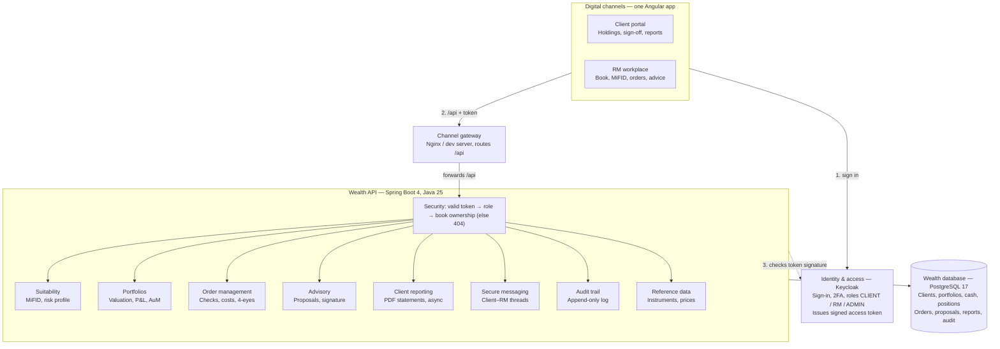

# Wealth Portal — Functional Overview

Wealth Portal is a front-office platform for private banking and wealth
management, in the Temenos Wealth / Channels style. It gives the **client** and
the **relationship manager (RM)** one place to profile the client, advise,
trade and report, with compliance controls built into every step.

> Demo project. Prices are sample values; order execution is simulated.

## Contents

1. [Purpose and scope](#1-purpose-and-scope)
2. [Actors and entitlements](#2-actors-and-entitlements)
3. [Core wealth data model](#3-core-wealth-data-model)
4. [Client profiling and suitability (MiFID II)](#4-client-profiling-and-suitability-mifid-ii)
5. [Portfolio management and RM workplace](#5-portfolio-management-and-rm-workplace)
6. [Order management (securities and derivatives)](#6-order-management-securities-and-derivatives)
7. [Investment proposals (advisory)](#7-investment-proposals-advisory)
8. [Client reporting](#8-client-reporting)
9. [Secure messaging and audit trail](#9-secure-messaging-and-audit-trail)
10. [Technical architecture and request flow](#10-technical-architecture-and-request-flow)
11. [Demo walkthrough and roadmap](#11-demo-walkthrough-and-roadmap)

---

## 1. Purpose and scope

The portal covers the advisory value chain from suitability to reporting:

- **Client profiling** — MiFID II suitability and appropriateness questionnaire, producing a risk profile (1–5) and a complex-products flag.
- **Portfolio management** — valuation, asset allocation, positions, cash and performance history per portfolio (mandate).
- **Order management** — security and listed-derivative orders with pre-trade compliance checks, ex-ante costs and charges, and four-eyes approval.
- **Investment advice** — investment proposals prepared by the RM, validated (e-signed) or declined by the client, then executed.
- **Client reporting** — statements, valuation, performance, transaction and costs reports as PDF.
- **Secure messaging** — client–RM conversation threads with unread tracking.
- **Audit trail** — immutable log of every sensitive action.

Out of scope today: real market connectivity (execution is simulated), custody
and settlement, corporate actions, fee billing and core-banking postings. In a
production setup these would come from a core banking / portfolio management
system (e.g. Temenos Transact / WealthSuite).

## 2. Actors and entitlements

Three roles sign in through Keycloak; each sees only its own book of business.
Entitlements are enforced in the API, not just hidden in the screens.

| Role | Who | Sees | Can do | Demo user |
|---|---|---|---|---|
| CLIENT | End client (private individual or entity) | Own portfolios, orders, proposals, reports, messages | Place orders on their execution-only portfolios, validate or decline proposals with e-signature, request reports, message the RM | `client1` / `Client#2026` |
| RM | Relationship manager / private banker | Own client book only | Run MiFID reviews, create and send proposals, place orders for clients, execute validated proposals, request reports, message clients | `rm1` / `Manager#2026` |
| ADMIN | Compliance / middle office | All clients and books | Four-eyes approval or rejection of orders flagged by pre-trade checks; supervision dashboard | `admin1` / `Admin#2026x` |

Access rules in the API:

- `/api/client/**` — CLIENT only; `/api/rm/**` — RM or ADMIN; `/api/admin/**` — ADMIN only.
- Shared endpoints (portfolios, orders, proposals, reports, messages) check ownership: a client sees only their own data; an RM only clients where they are the assigned RM. Anything else returns **404**, so other clients' existence is never revealed.
- Every sign-in is recorded with time, IP address and browser; the last sign-in is shown to the user at login (a common e-banking anti-fraud control).

## 3. Core wealth data model

A client owns one or more portfolios; each portfolio has a service type, cash
accounts and positions in instruments. Profiles, orders, proposals, reports and
messages hang off the client or the portfolio.

| Entity | Wealth meaning | Key attributes |
|---|---|---|
| Client | The bank's customer relationship | Client number, name, country, MiFID category (Retail, Professional, Eligible counterparty), assigned RM, portal login |
| Portfolio | A mandate / investment account | Portfolio number, reference currency, opening date, service type |
| Service type | The investment service agreed with the client | **Advisory** (RM advises, client decides), **Discretionary** (bank manages, no manual orders), **Execution-only** (client trades alone) |
| Cash account | Current account inside the portfolio, one per currency | Currency, balance; debited on buys, credited on sells |
| Position | A holding of one instrument | Quantity (bonds: nominal), average cost (bonds: % of nominal), re-averaged on each buy |
| Instrument | Security or listed derivative | ISIN / code, asset class (Equity, Bond, Fund, ETF, Option, Future), currency, exchange, risk class 1–7, complex-product flag, last price; options and futures add underlying, call/put, strike, expiry, contract size |
| Valuation history | Month-end performance index per portfolio | As-of date, index value; used for performance charts and reports |

Market value of a position = quantity × price × contract size; for bonds the
price is a percentage of nominal, so value = nominal × price ÷ 100.

Demo book: 8 clients (7 managed by `rm1`, 1 by another RM to prove book
segregation), 9 portfolios, 21 instruments (17 securities, 4 derivatives).

## 4. Client profiling and suitability (MiFID II)

No advice can be given without a valid suitability profile. The RM runs the
questionnaire with the client; the client accepts it; the result drives every
later check on orders and proposals.

**Questionnaire (version 2026.1)** — four sections, ten questions:

| Section | Questions | Scored |
|---|---|---|
| Objectives and horizon | Investment goal; holding horizon | Yes, 1–4 points each |
| Financial situation | Annual net income; share of total wealth; emergency reserve | Yes, 1–4 points each |
| Attitude to risk | Reaction to a 20% drawdown; maximum acceptable annual loss | Yes, 1–4 points each |
| Knowledge and experience | Equity experience; derivatives experience; leverage quiz | No — drives appropriateness |

**Risk profile** — the seven scored answers total 7–28 points:

| Points | Profile | Label | Highest instrument risk class allowed |
|---|---|---|---|
| 7–11 | 1 | Conservative | 3 |
| 12–15 | 2 | Cautious | 4 |
| 16–19 | 3 | Balanced | 5 |
| 20–23 | 4 | Growth | 6 |
| 24–28 | 5 | Dynamic | 7 |

**Appropriateness for complex products** — the client may trade options and
futures only with derivatives experience ("a few times" or "regularly") *and* a
correct answer to the leverage quiz ("can a call buyer lose more than the
premium?" → false).

**Profile lifecycle:**

1. **In progress** — the RM fills in the questionnaire; it can be saved and resumed.
2. **Pending validation** — complete, waiting for the client's decision.
3. **Valid** — accepted by the client; in force for 12 months, then flagged as expired on the RM dashboard.
4. **Superseded** — an older valid profile replaced by a newer one.
5. **Refused** — the client refused it; the previous profile stays in force.
6. **Cancelled** — abandoned by the RM.

## 5. Portfolio management and RM workplace

**RM dashboard (home)** — the advisor's action list:

- **Assets under management (AuM)** across the book; number of clients and portfolios.
- **MiFID alerts** — profiles awaiting client validation, missing or expired profiles, reviews in progress.
- **High cash** — portfolios holding more than 30% cash (an advisory opportunity).
- **Stale proposals** — sent more than 5 days ago without an answer.
- **Orders awaiting compliance approval.**
- **Clients needing attention** — a shortlist built from the alerts above.

**Client book** — searchable list of the RM's clients with category,
portfolios, AuM and MiFID status; the client page shows profile history and
starts a new MiFID review.

**Portfolio view** (RM and client):

| Figure | Definition |
|---|---|
| Total value | Market value of positions + cash |
| Invested value | Market value of positions |
| Cash and cash ratio | Cash balance and its share of total value |
| Unrealised P&L | Market value − cost value, per position and in total |
| Performance | Change of the valuation index over the period |
| Asset allocation | Value and weight per asset class |
| Positions | Instrument, quantity, average cost, last price, market value, weight, unrealised P&L |
| Performance chart | 12 month-ends of the valuation index |

From the portfolio the user can buy or sell a position, open an order ticket,
start a proposal (advisory portfolios) or request reports.

## 6. Order management (securities and derivatives)

Every order is priced and checked before it is booked: a **failed** check blocks
it, a **warning** sends it to compliance for four-eyes approval.

**Order ticket** — instrument search, side (buy / sell), quantity (bonds:
nominal; derivatives: contracts), order type, time in force, optional
negotiated fee, then a live preview of costs and checks.

| Order type | Behaviour |
|---|---|
| Market | Executes at the best available price |
| Limit | Executes only at the limit price or better |
| Stop | Becomes a market order once the stop price is reached |
| Stop limit | Becomes a limit order once the stop price is reached |

Time in force: **Day**, **GTC** (good till cancelled), **GTD** (good till date).

**Who may trade:** the RM (or admin) on any portfolio in the book except
discretionary ones; the client only on their own execution-only portfolios.

**Ex-ante costs and charges** (shown before confirmation, as MiFID II requires):

- Securities: 0.25% of the gross amount; listed derivatives: 2.50 per contract; minimum 15 in both cases.
- A negotiated fee replaces the standard fee; both are shown.
- Net amount = gross + fees on a buy, gross − fees on a sell.

**Pre-trade compliance checks:**

| Check | Pass | Warn (needs approval) | Fail (blocked) |
|---|---|---|---|
| Service type | Advisory or execution-only | — | Discretionary portfolio |
| Cash available (buy) | Net amount ≤ cash | — | Insufficient cash |
| Position held (sell) | Quantity ≤ holding | Derivatives: opens a short position | Securities: short selling |
| MiFID profile | Valid profile | Execution-only without profile | Advisory without profile |
| Risk profile match (buy) | Risk class ≤ profile + 2 | Risk class above what the profile allows | — |
| Appropriateness | Not complex, or client qualifies | Complex product on execution-only | Complex product on advisory |
| Concentration (buy) | Position ≤ 20% of portfolio after the trade | Above 20% | — |

**Order lifecycle:**

1. **Pending approval** — at least one warning; waits for compliance. The approver must differ from the person who placed it (four-eyes rule). Approve → placed; reject → rejected.
2. **Placed** — sent to the (simulated) market. Market orders fill at once; limit orders fill when the last price meets the limit; stop orders stay placed.
3. **Filled** — the cash account is debited or credited with the net amount; the position is opened, re-averaged, reduced or closed.
4. **Cancelled** — an open order withdrawn by its owner.
5. **Rejected** — refused by compliance.

Every step is written to the audit trail.

## 7. Investment proposals (advisory)

A proposal is the RM's documented investment advice: buy and sell lines on an
advisory portfolio, checked for suitability, signed by the client, then executed
as orders.

- Only the client's own RM can create, edit, send or execute a proposal, and only on an **advisory** portfolio.
- Each line runs the same pre-trade checks as an order. A proposal with any **failed** check cannot be sent; warnings are shown to RM and client.
- The client signs on screen (signature pad) to accept; the RM may capture the signature during a meeting.
- Clients never see working drafts — only proposals sent to them and later stages.
- A PDF of the proposal (lines, costs, checks, signature) can be downloaded at any stage.

| Stage (system status) | Shown as | Who acts | Next step |
|---|---|---|---|
| WORKING | Draft | RM edits or deletes | Send to client |
| SENT_FOR_VALIDATION | Awaiting client | Client (or RM in meeting) | Accept with signature, or decline with reason |
| VALIDATED | Accepted | RM | Execute: each line becomes a market order |
| REJECTED | Declined | — | End |
| EXECUTED | Executed | — | Orders follow the order lifecycle |

Proposals left in "Awaiting client" for more than 5 days appear on the RM
dashboard as a follow-up.

## 8. Client reporting

Reports are produced as PDF in the background: the user requests a report, sees
it as "in preparation", and downloads it when ready (usually within seconds).

| Report | Content | Regulatory purpose |
|---|---|---|
| Statement | Portfolio summary (value, cash, P&L) and recent transactions | Periodic client statement |
| Valuation | Holdings with quantity, price, market value, weight; asset allocation | Statement of assets |
| Performance | 12-month performance of the valuation index | Performance reporting |
| Transactions | Executed orders with price, amount and fees | Transaction record |
| Costs | Costs over the last 12 months and transaction costs by order | MiFID II ex-post costs and charges |

Each PDF carries the bank header, client and portfolio details, service type,
page numbers and generation date; file name `<type>-<portfolio number>-<date>.pdf`.

How it works: the request is stored as *pending*, a background worker builds the
PDF (Apache PDFBox) and marks it *ready* (or *failed* with a reason), and the
screen polls every 1.5 seconds. For the cloud version, PDFs are planned to move to
Azure Blob Storage with time-limited download links.

## 9. Secure messaging and audit trail

**Secure messaging** replaces e-mail for client–advisor communication, keeping
conversations inside the bank's controlled channel.

- One conversation thread per client, between the client and their RM.
- The RM sees all threads of their book; the client only their own.
- Opening a thread marks its messages as read; the menu shows an unread badge, refreshed every 30 seconds.

**Audit trail** — an append-only log of sensitive actions: who, what, when, with
a description (e.g. `ORDER_FILLED`, `PROPOSAL_VALIDATED`, `PROPOSAL_EXECUTED`,
MiFID review steps). A database trigger blocks any update or deletion of audit
rows. Sign-ins are logged separately with time, IP address and browser.

## 10. Technical architecture and request flow

Clients and RMs use the same Angular application with role-based screens; a
single wealth API applies entitlements and business rules and owns the wealth
database.

**What happens when an RM opens a client's portfolio:**

1. **Sign-in** — the RM authenticates at Keycloak and receives a signed access token naming the user and the RM role.
2. **Channel call** — the RM workplace calls `GET /api/portfolios/{id}` with the token; the channel gateway forwards everything under `/api` to the wealth API.
3. **Entitlement check** — the API verifies the token signature (with Keycloak's public keys, cached), the role, and that this client belongs to the RM's book; otherwise it answers 404.
4. **Business logic** — the Portfolios module values positions at last prices and computes P&L, allocation and performance.
5. **Data** — positions, cash and valuation history are read from the wealth database; the JSON answer returns the same way and the screen updates.

| Layer | Technology |
|---|---|
| Channels | Angular 22 (standalone components, signals, signal forms, httpResource), keycloak-js |
| Identity & access | Keycloak 26, OpenID Connect with PKCE; realm roles CLIENT, RM, ADMIN |
| Channel gateway | Angular dev server locally (port 4200); Nginx in the container image |
| Wealth API | Spring Boot 4.1, Java 25 (virtual threads), Spring Security resource server, OpenAPI / Swagger, Apache PDFBox (port 8090) |
| Wealth database | PostgreSQL 17, schema managed by Flyway migrations, demo data loaded separately |
| Delivery | Docker / Docker Compose locally; GitHub Actions CI (build, tests, CodeQL); Azure Container Apps planned |

## 11. Demo walkthrough and roadmap

Run locally at http://localhost:4200 (API documentation at
http://localhost:8090/swagger-ui.html). Two-factor sign-in is switched off for
the demo users.

1. **RM view** — sign in as `rm1`. Review the dashboard alerts (AuM, MiFID, high cash, stale proposals), open a client, start or resume a MiFID review and complete it.
2. **Order** — from a portfolio, buy an equity: see costs and checks. Try a derivative for a client without derivatives knowledge to see the appropriateness check.
3. **Proposal** — open the working proposal for Clara Dupont's portfolio, adjust lines and send it to the client.
4. **Client view** — sign in as `client1` (Clara): see the portfolio, accept the proposal with a signature, request a statement and download it, reply to the RM's message.
5. **Execution** — back as `rm1`, execute the accepted proposal and check the filled orders and updated positions.
6. **Compliance** — sign in as `admin1`: approve or reject the order waiting for four-eyes approval.

**Roadmap:**

| Phase | Content |
|---|---|
| Cloud (next) | Azure deployment: Container Apps, PostgreSQL Flexible Server, Key Vault, GitHub Actions with OIDC; two-factor sign-in back on |
| Admin | Questionnaire versions editor, user and RM assignment, instrument maintenance |
| Real-time | Server-sent events for report and order updates instead of polling |
| Documents | Reports in Blob Storage; scheduled quarterly statements |
| Quality | Integration tests with Testcontainers; end-to-end UI tests |
